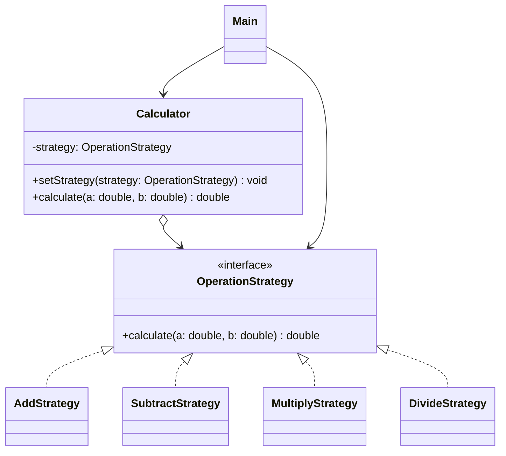

# Assignment 5 - Strategy Pattern

## 1. Introduction

For this assignment, I chose a simple calculator written in Java 17.

The calculator supports four operations: addition, subtraction, multiplication, and division.

I used the Strategy Pattern because each mathematical operation is a separate algorithm.

All operations implement the same interface called `OperationStrategy`. The `Calculator` class can switch between them during runtime.

## 2. UML Class Diagram

The `OperationStrategy` interface defines the common method.

Each strategy implements one operation. The `Calculator` class uses the selected strategy, and `Main` handles user input.

## 3. Clean Code Principles

### 3.1. Polymorphism Instead of Conditionals

Without Strategy, the calculator could use many if-else statements:

`if (choice.equals("1")) result = a + b;`

In my implementation, I use:

`OperationStrategy strategy = strategies.get(choice);`

Each operation has its own class. The calculator does not need to check which operation is selected.

### 3.2. Meaningful Names

I used simple class names such as `AddStrategy`, `SubtractStrategy`, `MultiplyStrategy`, and `DivideStrategy`.

For example:

`new AddStrategy()`

It is easy to understand what this class does just by reading its name.

### 3.3. Single Responsibility Principle

Each strategy class has one responsibility.

For example, `AddStrategy` only performs addition:

`return a + b;`

It does not handle input, menus, or other operations.

### 3.4. Encapsulation

The `Calculator` class stores its strategy in a private variable:

`private OperationStrategy strategy;`

It calls the selected algorithm using:

`return strategy.calculate(a, b);`

This means the calculator does not need to know how each operation works internally.

### 3.5. Open/Closed Principle

The calculator can support new operations without changing the `Calculator` class.

For example, I added `DivideStrategy` as another implementation of `OperationStrategy`.

The strategy can be changed using:

`calculator.setStrategy(new DivideStrategy());`

This makes the program easier to extend.

## 4. Strategy vs. State Pattern

Strategy and State patterns have similar structures, but they have different purposes.

Strategy is used when we want to choose between different algorithms. In my calculator, the user selects an operation.

State is used when an object's behavior changes depending on its internal state.

I used Strategy because the calculator needs interchangeable mathematical operations, not different internal states.

## 5. Conclusion

In this assignment, I learned how to use the Strategy Pattern in Java.

The main advantage is that I can add new operations without changing the calculator logic.

The disadvantage is that I need to create more classes, even for simple operations.

Overall, the Strategy Pattern makes the program more flexible and easier to understand.

## 6. GitHub Repository
https://github.com/lonelysun21/SDP_5_assignment