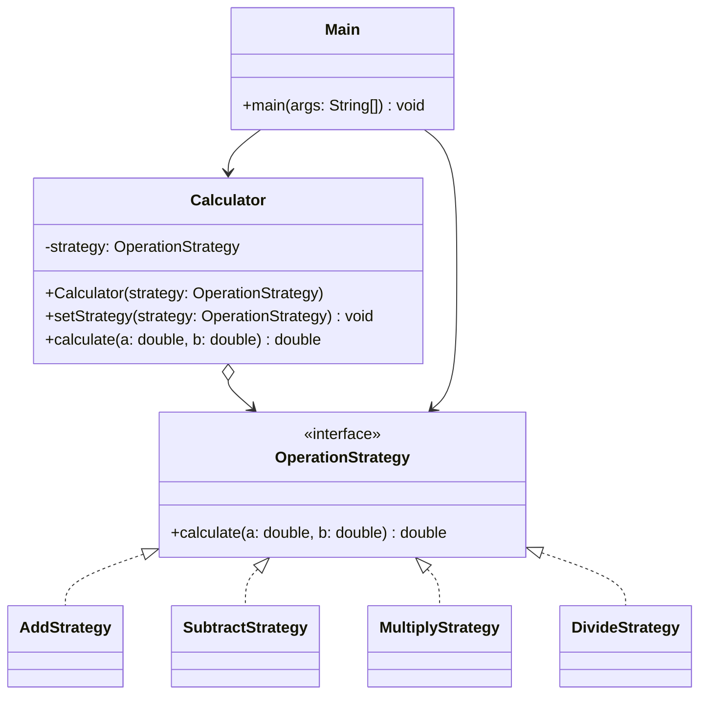

# Assignment 5 - Strategy Pattern

## 1. Introduction

For this assignment, I chose a simple calculator written in Java 17.

The calculator supports four operations: addition, subtraction, multiplication, and division.

I used the Strategy Pattern because each mathematical operation is a separate algorithm.

All operations implement the same interface called `OperationStrategy`. The `Calculator` class can switch between them during runtime.

## 2. UML Class Diagram



The `OperationStrategy` interface defines the common method for all operations.

The four strategy classes implement different calculations.

`Calculator` is the Context. It stores the current strategy and calls its method.

`Main` is the Client. It selects the strategy based on user input.

## 3. Clean Code Principles

### 3.1. Polymorphism Instead of Conditionals

Without the Strategy Pattern, the calculator could use multiple if-else statements to choose an operation.

Before (simplified example):

```java
if (choice.equals("1")) {
    result = a + b;
} else if (choice.equals("2")) {
    result = a - b;
}
```

After:

```java
OperationStrategy strategy = strategies.get(choice);
calculator.setStrategy(strategy);
double result = calculator.calculate(a, b);
```

Now each operation has its own class. The `Calculator` class does not need if-else statements to choose an algorithm. The `Main` class still checks for invalid user input.

### 3.2. Meaningful Names

Class names should clearly describe their purpose.

Before (example of unclear naming):

```java
class Operation1 {
}
```

After:

```java
public class AddStrategy implements OperationStrategy {
    @Override
    public double calculate(double a, double b) {
        return a + b;
    }
}
```

I used names like `AddStrategy`, `SubtractStrategy`, `MultiplyStrategy`, and `DivideStrategy`.

These names make the program easier to read because each class name describes its operation.

### 3.3. Single Responsibility Principle

Each class should have one main responsibility.

Before (example with mixed responsibilities):

```java
public double calculate(double a, double b) {
    System.out.println("Calculating...");
    return a + b;
}
```

After (`AddStrategy.java`):

```java
public double calculate(double a, double b) {
    return a + b;
}
```

In my project, `AddStrategy` only performs addition.

`Main` handles user input and output. `Calculator` delegates calculations to the selected strategy.

This makes the classes smaller and easier to understand.

### 3.4. Encapsulation

Encapsulation helps protect the internal data of a class.

Before (example with a public field):

```java
public OperationStrategy strategy;
```

After (`Calculator.java`):

```java
private OperationStrategy strategy;

public void setStrategy(OperationStrategy strategy) {
    this.strategy = strategy;
}
```

The strategy field is private, so other classes cannot change it directly.

Instead, they use the `setStrategy()` method.

The calculator executes the selected operation through:

```java
return strategy.calculate(a, b);
```

This keeps the internal implementation hidden from the client.

### 3.5. Open/Closed Principle

The Open/Closed Principle means that classes should support extension without changing their existing logic.

Before (example with operations inside the context):

```java
if (choice.equals("1")) {
    return a + b;
} else if (choice.equals("2")) {
    return a - b;
}
```

After (`DivideStrategy.java`):

```java
public class DivideStrategy implements OperationStrategy {
    @Override
    public double calculate(double a, double b) {
        if (b == 0) {
            throw new ArithmeticException("Cannot divide by zero");
        }

        return a / b;
    }
}
```

To use this strategy, the client can write:

```java
calculator.setStrategy(new DivideStrategy());
```

I can add new mathematical operations by creating new strategy classes.

I only need to update the menu in `Main` to make a new strategy selectable. The existing `Calculator` class does not need to change.

## 4. Strategy vs. State Pattern

Strategy and State patterns have similar structures, but they have different purposes.

Strategy is used when we want to choose between different algorithms. In my calculator, the user selects a mathematical operation.

State is used when an object's behavior depends on its internal state. A state change can also affect which behavior is used next.

I chose Strategy because the user can select and switch between independent mathematical operations. The calculator does not have a state machine.

## 5. Conclusion

In this assignment, I learned how to use the Strategy Pattern in Java.

The main advantage is that I can add new operations without changing the calculator logic.

The disadvantage is that I need to create more classes, even for simple operations.

Overall, the Strategy Pattern makes the program more flexible and easier to understand.

## 6. GitHub Repository

https://github.com/lonelysun21/SDP_5_assignment

## References

1. Ospanov, A. *Lecture 7: The Strategy Pattern*. Software Design Patterns course materials, Astana IT University.
2. Refactoring.Guru. *Strategy Design Pattern*. https://refactoring.guru/design-patterns/strategy
